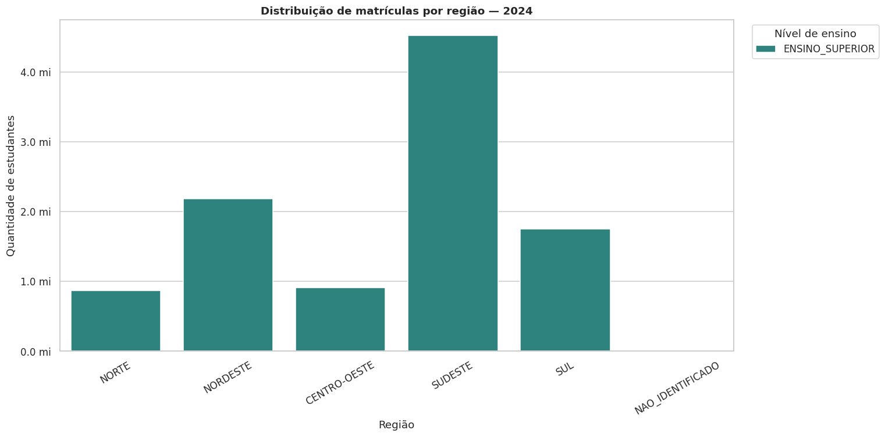
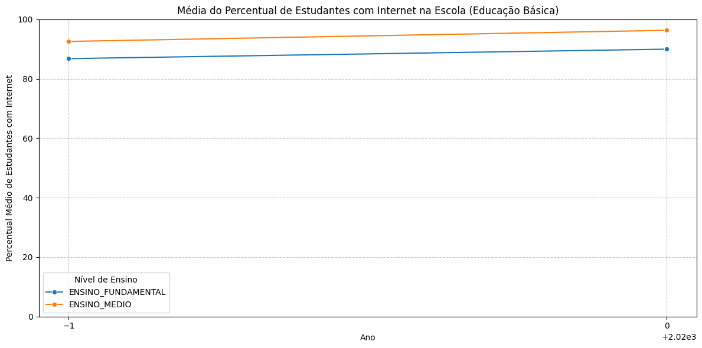
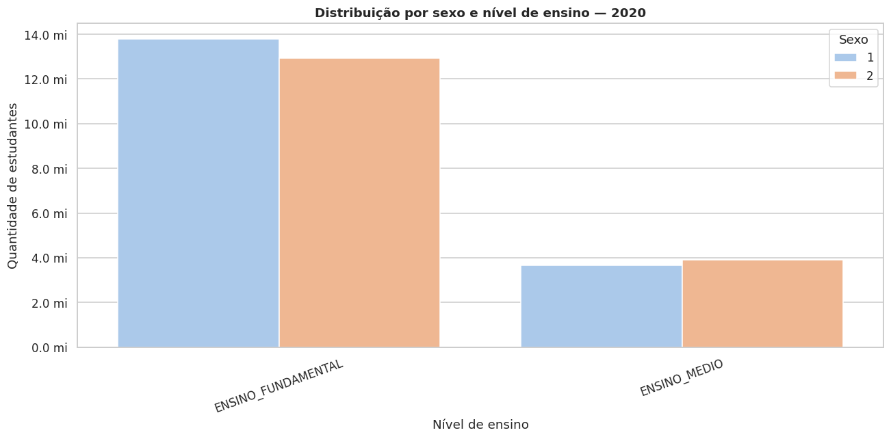

# Perfil dos Estudantes Brasileiros — Analytics Educacional

> **Pergunta central:** como evoluíram o perfil dos estudantes, a distribuição das matrículas e os indicadores de infraestrutura educacional desde 2015 até o ano corrente?

    

## Resumo executivo

Este projeto transforma dados públicos do INEP em uma base analítica para responder perguntas sobre volume de matrículas, perfil dos estudantes, desigualdades territoriais e infraestrutura educacional. O trabalho combina **GoogleSQL/BigQuery**, **Python/Colab** e **Power BI**, com uma camada adicional preparada para clusterização, classificação e previsão.

### O que este projeto demonstra

- modelagem e agregação de dados educacionais em diferentes granularidades;
- integração entre Educação Básica, Ensino Superior e diretórios municipais;
- tratamento explícito de nulos, denominadores e indicadores não aplicáveis;
- construção de uma base municipal-anual para análise territorial;
- criação de um índice de infraestrutura escolar de 0 a 100;
- preparação de dados para Machine Learning e séries temporais;
- documentação de reprodução, validação e regras de negócio.

### Ferramentas

`GoogleSQL` · `BigQuery` · `Python` · `Pandas` · `Matplotlib` · `Seaborn` · `Power BI` · `Git/GitHub`

## Visão rápida

Este projeto integra dados do Censo Escolar, do Censo da Educação Superior e de diretórios municipais disponibilizados pela [Base dos Dados](https://basedosdados.org/). A solução transforma fontes com diferentes níveis de granularidade em uma base analítica comum para exploração demográfica, geográfica, institucional e de infraestrutura.

**Escopo SQL:** 2015 até o ano corrente da execução, usando `EXTRACT(YEAR FROM CURRENT_DATE())` como limite superior. O notebook versionado contém uma execução histórica de 2019–2023; seus outputs e gráficos precisam ser reexecutados para refletir os anos mais recentes disponíveis.

**Granularidade:** as saídas são agregadas por dimensões analíticas. `qtd_estudantes` representa registros ou matrículas disponíveis na fonte, e não uma linha individual por estudante.

## Principais perguntas de negócio

- Como evoluíram as matrículas por nível de ensino, região e ano?
- Quais diferenças territoriais aparecem entre as regiões brasileiras?
- Como evoluíram os indicadores de acesso à internet e infraestrutura escolar?
- Quais municípios apresentam perfis semelhantes de infraestrutura?
- É possível classificar o nível de infraestrutura do ano seguinte com base nas características atuais?
- Como construir uma série temporal estadual para comparar baselines de previsão?

## Entregas analíticas

| Camada | Entrega | Finalidade |
|---|---|---|
| SQL analítico | `consulta_principal.sql` | Base consolidada para exploração e BI |
| SQL territorial | `02_base_infraestrutura_municipio_ano.sql` | Indicadores por município e ano |
| Índice | `03_indice_infraestrutura.sql` | Índice de infraestrutura de 0 a 100 |
| Machine Learning | `04_base_modelagem_cluster.sql` | Entrada para clusterização |
| Machine Learning | `05_base_modelagem_classificacao.sql` | Classificação usando o ano seguinte como alvo |
| Séries temporais | `06_serie_temporal_previsao.sql` | Série anual por UF |
| Qualidade | `07_validacoes_modelagem.sql` | Testes de duplicidade, cobertura e intervalos |

Detalhes de cada entrega estão em [`docs/entregas_sql.md`](docs/entregas_sql.md).

## Prévia visual — execução histórica

Os gráficos abaixo são uma prévia da narrativa analítica produzida pelo notebook versionado. Eles representam uma execução histórica de 2019–2023, não a janela dinâmica completa desde 2015. Após a execução das consultas no BigQuery, o notebook deverá ser reexecutado e estas imagens deverão ser substituídas.

### Evolução das matrículas por nível de ensino


### Distribuição regional no último ano da execução histórica



### Acesso à internet na Educação Básica



### Distribuição por sexo e nível de ensino



> **Próxima atualização visual:** reexecutar o notebook com a janela 2015–ano corrente, corrigir a escala do eixo temporal do gráfico de internet e substituir gráficos de distribuição simples por visualizações com comparação temporal e participação percentual.

## Arquitetura

```text
INEP / Base dos Dados → BigQuery → base consolidada
                                      ↓
                      base município-ano e indicadores
                             ↙          ↓          ↘
                    clusterização  classificação  previsão
                             ↘          ↓          ↙
                           Python/Colab e Power BI
```

## Regras analíticas importantes

- A Educação Básica e o Ensino Superior são integrados por `UNION ALL`, mas não possuem exatamente as mesmas dimensões disponíveis.
- No Ensino Superior, algumas dimensões demográficas são marcadas como agregadas e alguns indicadores da Educação Básica ficam nulos.
- Os percentuais são derivados dos respectivos agrupamentos; não devem ser somados entre linhas.
- A consulta usa `SAFE_DIVIDE` e tratamento de nulos para evitar erros em denominadores zerados ou campos não aplicáveis.
- A saída é agregada por dimensões analíticas; `qtd_estudantes` representa registros ou matrículas disponíveis na fonte, e não uma linha individual por estudante.
- Os percentuais de água, energia, esgoto, internet para alunos, biblioteca/sala de leitura e laboratório de ciências foram incluídos para apoiar a próxima etapa de construção do índice de infraestrutura.

## Estrutura real

```text
README.md
docs/
├── Dicionario_de_Dados.md
├── entregas_sql.md
├── modelagem_sql.md
├── validacao_consulta.md
└── reproducibilidade.md
power-bi/
├── bi_perfil_estudante_brasileiro.pbip
├── bi_perfil_estudante_brasileiro.pbix
└── especificacao_funcional_do_dashboard.md
python/
└── Perfil_Estudantes_Brasileiros.ipynb
sql/
├── consulta_principal.sql
├── 02_base_infraestrutura_municipio_ano.sql
├── 03_indice_infraestrutura.sql
├── 04_base_modelagem_cluster.sql
├── 05_base_modelagem_classificacao.sql
├── 06_serie_temporal_previsao.sql
└── 07_validacoes_modelagem.sql
```

A especificação funcional descreve uma evolução de oito páginas. O artefato versionado atual contém uma página e sete visuais; portanto, a especificação deve ser lida como roadmap do dashboard, e não como descrição de uma entrega já concluída.

## Reprodução

1. Leia [`docs/reproducibilidade.md`](docs/reproducibilidade.md).
2. Leia [`docs/entregas_sql.md`](docs/entregas_sql.md) para entender o que cada script entrega.
3. Configure um projeto Google Cloud próprio para cobrança/quota do BigQuery.
4. Execute [`sql/consulta_principal.sql`](sql/consulta_principal.sql) no GoogleSQL.
5. Execute [`docs/validacao_consulta.md`](docs/validacao_consulta.md) e registre os resultados.
6. Leia [`docs/modelagem_sql.md`](docs/modelagem_sql.md) para criar as tabelas específicas de modelagem.
7. Para a exploração em Python, abra o notebook e ajuste `project_id` para o seu projeto.
8. Valide o período efetivamente retornado, os totais por nível de ensino e os nulos esperados antes de construir visualizações.

## Roadmap

1. Executar as sete consultas no BigQuery e registrar a cobertura real dos dados.
2. Reexecutar o notebook desde 2015 e atualizar outputs, métricas e gráficos.
3. Criar o notebook de clusterização e interpretar os perfis municipais.
4. Criar o notebook de classificação com validação temporal e matriz de confusão.
5. Criar o notebook de previsão com comparação de baselines e métricas de erro.
6. Atualizar o Power BI com os novos indicadores e publicar screenshots do dashboard.

## Documentação

- [`docs/entregas_sql.md`](docs/entregas_sql.md) — o que cada script entrega;
- [`docs/modelagem_sql.md`](docs/modelagem_sql.md) — fluxo até o Colab;
- [`docs/Dicionario_de_Dados.md`](docs/Dicionario_de_Dados.md) — campos e regras;
- [`docs/validacao_consulta.md`](docs/validacao_consulta.md) — testes de qualidade;
- [`docs/reproducibilidade.md`](docs/reproducibilidade.md) — como executar o projeto.

## Autor

**Marcelo dos Santos Sampaio** · [LinkedIn](https://linkedin.com/in/msampaioac) · [GitHub](https://github.com/msampaioac)
