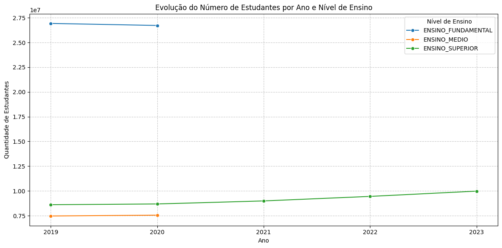
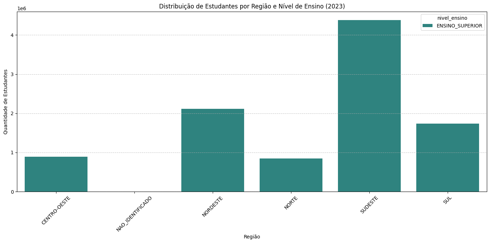
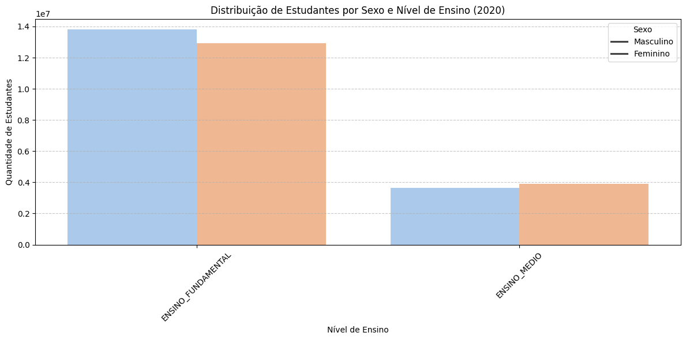

# Perfil dos Estudantes Brasileiros (2019–2023)

> **Pergunta central:** como evoluíram o perfil dos estudantes, a distribuição das matrículas e os indicadores de infraestrutura educacional entre 2019 e 2023?

   

## Visão rápida

Este projeto integra dados do Censo Escolar, do Censo da Educação Superior e de diretórios municipais disponibilizados pela [Base dos Dados](https://basedosdados.org/). A solução transforma fontes com diferentes níveis de granularidade em uma base analítica comum para exploração demográfica, geográfica, institucional e de infraestrutura.

**Escopo implementado:** 2019–2023. O notebook executado retorna 1.648.945 linhas e 48 colunas; os valores são agregados por dimensões analíticas e não representam uma linha individual por estudante.

## Insights demonstrados no notebook

- O notebook cobre os cinco anos de 2019 a 2023 e separa Ensino Fundamental, Ensino Médio e Ensino Superior.
- Na saída registrada para 2019, foram contabilizados 26.923.730 estudantes no Ensino Fundamental, 7.465.891 no Ensino Médio e 8.604.526 no Ensino Superior.
- Na Educação Básica, o percentual médio de estudantes em escolas com internet no notebook foi de 86,79% no Ensino Fundamental e 92,57% no Ensino Médio em 2019; a métrica deve ser interpretada como média dos agrupamentos, não como média ponderada nacional.
- Os indicadores de infraestrutura e inclusão possuem valores nulos para dimensões em que a fonte não se aplica, especialmente no Ensino Superior. Isso é uma característica do modelo integrado, não necessariamente ausência do indicador.

## Prévia visual

Os gráficos abaixo são extraídos do notebook executado e permitem avaliar rapidamente a narrativa analítica antes de abrir o Power BI.








## Arquitetura

```text
INEP / Base dos Dados → BigQuery → CTEs e regras de negócio
                                      ↓
                         base analítica consolidada
                              ↙              ↘
                    notebook Python       Power BI
```

## Regras analíticas importantes

- A Educação Básica e o Ensino Superior são integrados por `UNION ALL`, mas não possuem exatamente as mesmas dimensões disponíveis.
- No Ensino Superior, algumas dimensões demográficas são marcadas como agregadas e alguns indicadores da Educação Básica ficam nulos.
- Os percentuais são derivados dos respectivos agrupamentos; não devem ser somados entre linhas.
- A consulta usa `SAFE_DIVIDE` e tratamento de nulos para evitar erros em denominadores zerados ou campos não aplicáveis.

## Estrutura real

```text
README.md
docs/
├── Dicionario_de_Dados.md
└── reproducibilidade.md
power-bi/
├── bi_perfil_estudante_brasileiro.pbip
├── bi_perfil_estudante_brasileiro.pbix
└── especificacao_funcional_do_dashboard.md
python/
└── Perfil_Estudantes_Brasileiros.ipynb
sql/
└── consulta_principal.sql
```

A especificação funcional descreve uma evolução de oito páginas. O artefato versionado atual contém uma página e sete visuais; portanto, a especificação deve ser lida como roadmap do dashboard, e não como descrição de uma entrega já concluída.

## Reprodução

1. Leia [`docs/reproducibilidade.md`](docs/reproducibilidade.md).
2. Configure um projeto Google Cloud próprio para cobrança/quota do BigQuery.
3. Execute [`sql/consulta_principal.sql`](sql/consulta_principal.sql) no GoogleSQL.
4. Para a exploração em Python, abra o notebook e ajuste `project_id` para o seu projeto.
5. Valide o período, os totais por nível de ensino e os nulos esperados antes de construir visualizações.

## Próximos passos

- publicar screenshots do dashboard;
- transformar as oito páginas planejadas em uma entrega implementada ou reduzir a especificação ao escopo atual;
- adicionar testes de qualidade e métricas DAX para os KPIs documentados;
- produzir uma análise ponderada nacional para evitar interpretar médias de agrupamentos como totais nacionais.

## Autor

**Marcelo dos Santos Sampaio** · [LinkedIn](https://linkedin.com/in/msampaioac) · [GitHub](https://github.com/msampaioac)
