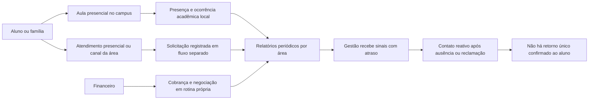
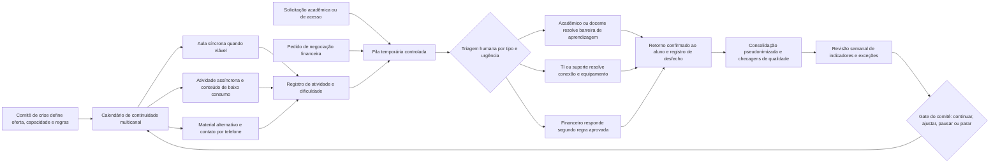

# COVID-19: mapa de processos e governança da resposta simulada

> **Processos presumidos para um estudo fictício.** Este documento não descreve fluxos reais da GENA nem uma implantação ocorrida. O desenho posterior é uma proposta para o cenário de 2020. A cronologia publicada informa que o CRM e os primeiros painéis só aparecem em 2022; portanto, o fluxo de 2020 usa um registro temporário controlado, não um CRM ou dashboard integrado.

[README de Governança](../README.md) · [Resposta estratégica](../../planejamento-estrategico/docs/simulacao-resposta-covid19.md) · [Espelho de resultados simulados](../../retencao-ead/docs/simulacao-covid19-resultados.md)

## Processo presumido antes da crise

O mapa abaixo é uma hipótese de trabalho para testar a fragilidade de um modelo centrado no campus, com informações acadêmicas, financeiras e de atendimento separadas. Não é um levantamento de processo real.

**Fragilidades simuladas:** o campus deixa de ser canal disponível; professor, atendimento e financeiro não veem a mesma fila; a direção não dispõe de um retrato semanal de continuidade; e a ausência de interação pode significar falta de conexão, problema acadêmico ou outra situação — não necessariamente desinteresse.

## Processo proposto após as decisões

O fluxo propõe canais alternativos e uma rotina curta de revisão. Em 2020, o registro seria uma planilha ou sistema temporário com acesso restrito, identificador pseudonimizado, responsável, prazo e histórico de atualização. A adoção de CRM é mantida para a etapa posterior já registrada na cronologia fictícia da GENA.

O relatório da OCDE documenta soluções multimodais, atenção a desigualdades de acesso e uso de feedback; a triagem humana deste mapa é uma escolha de desenho para o cenário, não uma alegação sobre a GENA real [1]. A resposta rápida ao ensino remoto também aparece em orientações do Banco Mundial para o período [2].

## Contrato mínimo dos indicadores

| Indicador | Fórmula do cenário | Responsável fictício | Frequência e decisão | Maturidade e limite de interpretação |
|:---|:---|:---|:---|:---|
| Continuidade de aulas | Aulas entregues ÷ 300 aulas planejadas em 56 dias | Coordenação Acadêmica | Revisão semanal; reorganizar oferta quando a execução ficar abaixo do plano aprovado | Calendário e denominador ficam fixos no dia 0; a leitura final deste espelho só amadurece no dia 56 |
| Participação recorrente | Alunos com ao menos uma atividade validada em ≥4 semanas distintas ÷ coorte fixa de 1.000 | Acadêmico + Dados | Sinal semanal; investigar falta de acesso e obstáculos, sem inferir desinteresse | Leituras anteriores ao dia 56 são parciais; atividade precisa cobrir quatro semanas distintas |
| Resolução de barreira de acesso | Necessidades resolvidas em até 10 dias úteis ÷ 200 necessidades identificadas | TI + Núcleo Digital | Revisão semanal; priorizar barreiras não atendidas | Só entram no resultado casos com janela completa de 10 dias úteis; resolução é suporte concluído, não contato tentado |
| SLA de suporte | Solicitações resolvidas em até 48h ÷ 150 solicitações recebidas | Atendimento | Revisão semanal; reforçar capacidade se o SLA cair | Só entram solicitações cuja janela de 48h amadureceu; solicitações vencidas e não resolvidas não cumprem o SLA |
| Resposta financeira | Pedidos com primeira resposta em até 5 dias úteis ÷ 160 pedidos recebidos | Financeiro | Revisão semanal; medir serviço e fila | Só entram pedidos com janela completa de 5 dias úteis; resposta não significa acordo, pagamento ou recuperação |
| Cancelamentos em 8 semanas | Cancelamentos registrados ÷ 1.000 matrículas ativas no início | Registro Acadêmico | Acumulado semanal; separar conclusões e transferências | Coorte e janela de 56 dias fixas; não anualizar nem chamar a diferença entre ramos de efeito causal |

O espelho usa uma janela acumulada de 56 dias (oito semanas), como marco intermediário do plano de 90 dias; a decisão final ocorre no dia 90 e não extrapola as taxas. As premissas e os cálculos estão em [covid19_config.json](../../retencao-ead/dados/covid19_config.json) e [covid19_espelho_resultados.csv](../../retencao-ead/dados/covid19_espelho_resultados.csv). Os valores são simulações em ramos sem pacote coordenado e com pacote hipotético, não resultados medidos.

## Regras de governança e controle

- O comitê reúne Direção, Acadêmico, TI, Atendimento, Financeiro e Dados. Nos primeiros dias, a rotina pode ser diária; depois, semanal, com decisão, responsável, prazo e evidência registrados.
- O registro temporário contém apenas dados necessários para encaminhar e acompanhar solicitações. Acesso por papel, trilha de alteração, prazo de retenção e revisão humana são requisitos do desenho.
- O denominador e o período de cada indicador ficam versionados. Mudanças de definição são registradas como decisão, nunca aplicadas silenciosamente.
- Toda taxa reporta numerador, denominador e janela. Solicitações de suporte e de negociação não são confundidas com alunos, pagamentos ou resultados acadêmicos.
- A decisão de continuar, ajustar, pausar ou parar considera execução, acesso, experiência, capacidade e previsão de caixa. O espelho sintético não substitui validação do negócio.

## Referências

[1]: https://www.oecd.org/en/publications/how-learning-continued-during-the-covid-19-pandemic_bbeca162-en.html "How Learning Continued during the COVID-19 Pandemic"
[2]: https://openknowledge.worldbank.org/entities/publication/a7aecfed-7493-599c-a663-97ab1947c875 "Remote Learning and COVID-19"
