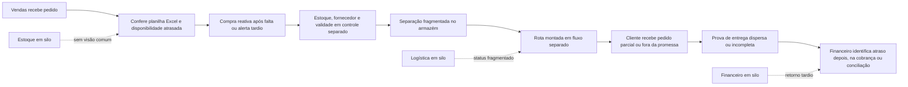
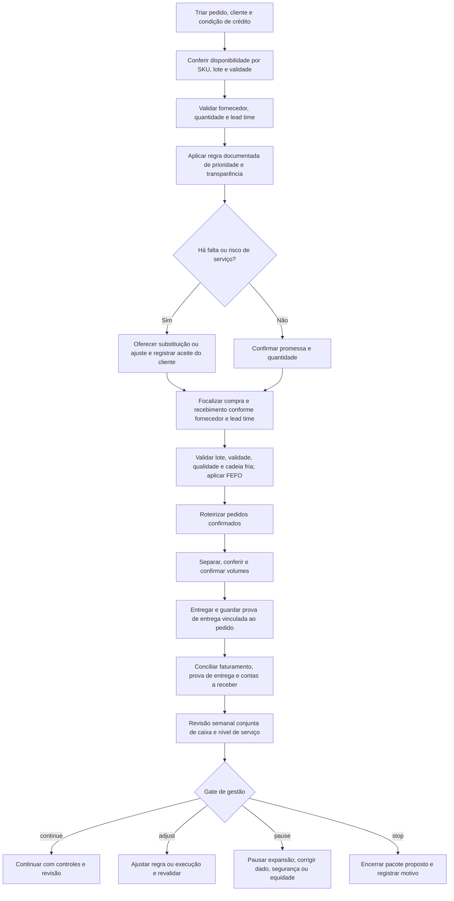

# Simulação COVID-19: processos e indicadores

**Estudo de portfólio · NorteVia Distribuição · cenário inteiramente hipotético**

[Empresa NorteVia Distribuição](../../../README.md) · [Governança de indicadores](../README.md) · [Abastecimento e logística](../../abastecimento-logistica/README.md) · [Planejamento estratégico](../../planejamento-estrategico/README.md)

> NorteVia Distribuição é fictícia: um atacadista B2B de alimentos em Rio Branco-AC, com um armazém e clientes como pequenos mercados e operações de food service. Os fluxos e números deste documento são construídos para simulação. Não houve operação, implantação, validação executiva ou medição real descrita aqui.

A OCDE relata que a COVID-19 afetou segmentos distintos das cadeias alimentares — produção agrícola, processamento, transporte e logística e demanda final — em diferentes extensões, sem afetar uniformemente setores e produtos [1]. Esse é somente o contexto geral para desenhar uma resposta ponta a ponta. Nenhuma cifra da publicação foi convertida ou atribuída aos números fictícios abaixo.

## Mapa de processo antes: fluxo fragmentado

O mapa representa uma hipótese de diagnóstico didática, não uma descoberta feita em uma empresa. A conferência em planilha e a atualização tardia representam a fragmentação que a proposta pretende tornar visível.

**Leitura do risco:** o pedido, a disponibilidade por SKU/lote/validade, o abastecimento, a separação e a rota não compartilham uma definição única de promessa. Sem evidência logística ligada ao pedido, a conciliação de entrega e contas a receber pode ocorrer depois que o problema já afetou o cliente e o caixa.

## Mapa de processo depois: pacote coordenado hipotético

O desenho proposto liga o registro do pedido à decisão de serviço e caixa. “Depois” nomeia o ramo hipotético com pacote coordenado; não afirma que esse processo existiu nem que produziu os resultados ilustrativos.

A regra de priorização deve ser aprovada, visível às áreas e aplicada com revisão humana; nenhuma fila automatizada ou recurso de sistema é presumido. Uma substituição só conta como aceita quando o cliente consente e isso fica registrado. Compra focalizada considera necessidades confirmadas, disponibilidade do fornecedor e lead time, sem especulação. FEFO significa primeiro a vencer, primeiro a sair; respeitar qualidade e cadeia fria prevalece sobre o indicador de disponibilidade.

## Contrato dos seis KPIs

As duas colunas são ramos hipotéticos comparáveis sob os contratos fixados abaixo. **Não são resultados antes/depois observados, nem estimativa causal ou promessa de ganho.** Os dados são deliberadamente ilustrativos e não representam uma empresa real.

| Indicador | Ramo hipotético: sem pacote coordenado | Ramo hipotético: com pacote hipotético |
|:---|---:|---:|
| OTIF — pedidos completos e no prazo | 62/100 = 62% | 82/100 = 82% |
| Fill rate — unidades atendidas | 8.000/10.000 = 80% | 9.100/10.000 = 91% |
| Disponibilidade — SKU-dias com saldo vendável | 250/400 = 62,5% | 340/400 = 85% |
| Avaria/validade — caixas afetadas | 35/1.000 = 3,5% | 20/1.000 = 2,0% |
| Alocação de transporte por pedido planejado | R$ 9.200/100 = R$ 92,00 | R$ 8.400/100 = R$ 84,00 |
| Contas a receber vencidas há mais de 30 dias | R$ 220.000/R$ 1.000.000 = 22% | R$ 150.000/R$ 1.000.000 = 15% |

### Regras comuns de janela e maturidade

Para esta simulação, cada ramo usa uma coorte fixa de **100 pedidos planejados** com data de entrega prometida dentro da mesma janela de **40 dias úteis**. O conjunto de **10 SKUs** é congelado antes do início; disponibilidade é observada uma vez por SKU em cada um desses 40 dias úteis, totalizando **400 SKU-dias**. O cutoff da janela é o dia 56 (40 dias úteis hipotéticos). Provas e conciliações podem maturar por até **5 dias úteis adicionais**, com fechamento previsto até o dia 63; isso não estende a observação. O corte do contas a receber permanece no dia 56. Nenhum pedido, SKU, caixa ou valor é removido retroativamente por causa do desfecho. A comparação exige as mesmas definições e janela nos dois ramos.

Os 40 dias úteis são uma subjanela hipotética dentro dos 56 dias corridos; o fechamento documental até o dia 63 é apenas maturidade de registro, não extensão da observação. Não há meta corporativa validada. Os percentuais e valores unitários são razões aritméticas dos numeradores e denominadores declarados.

### Contratos, responsabilidades e limites

| KPI e fórmula | População, denominador e janela fixos | Responsável fictício e cadência | Limites de interpretação e controles |
|:---|:---|:---|:---|
| **OTIF.** Numerador: pedidos entregues completos e até a data prometida registrada antes da execução. Denominador: pedidos planejados elegíveis. Fórmula: numerador ÷ denominador. Completo significa todas as linhas e quantidades solicitadas atendidas; parcial ou atraso falha no critério conjunto. | 62 ou 82 pedidos ÷ **100 pedidos planejados**; mesma coorte de 40 dias úteis e maturidade documental de 5 dias úteis. Cancelamentos, cortes e substituições não aceitas permanecem no denominador. | Responsável de Vendas/Pedidos valida pedido e promessa; Logística valida entrega e evidência. Registrar por pedido; reconciliar e revisar semanalmente, fechar após maturidade. | Não informa sozinho causa do atraso ou satisfação. Preservar pedido e promessa originais; mudança só com horário, autor, motivo e aceite do cliente. Uma prova encontrada após a data não transforma entrega atrasada em pontual. |
| **Fill rate em unidades.** Fórmula: unidades solicitadas atendidas ÷ unidades solicitadas elegíveis. Numerador: unidades entregues da linha original; substituto aceito somente se houver equivalência de unidade aprovada e consentimento registrado. | **8.000 ou 9.100 unidades ÷ 10.000 unidades solicitadas** nos mesmos 100 pedidos planejados da coorte de 40 dias úteis; maturidade de 5 dias úteis. | Responsável de Vendas/Pedidos valida solicitação e aceite; Armazém valida quantidade separada; Logística valida quantidade entregue. Atualização por pedido e revisão semanal. | Unidades de SKUs diferentes não são somáveis sem unidade comercial coerente. Não mede margem, valor nutricional nem adequação do substituto. Manter solicitado, atendido, cortado e substituído em campos separados. |
| **Disponibilidade.** Fórmula: SKU-dias com saldo vendável confirmado ÷ SKU-dias elegíveis. Conta como disponível se houver saldo utilizável no snapshot definido, por SKU/lote/validade, compatível com qualidade e conservação; saldo bloqueado ou sem rastreabilidade não conta. | **250 ou 340 SKU-dias ÷ 400 SKU-dias**; mesmos 10 SKUs congelados × 40 dias úteis, com um snapshot por SKU/dia em horário de corte fixo. | Responsável de Armazém/Qualidade confirma saldo, lote, validade e cadeia fria; Abastecimento revisa reposição. Registro diário, reconciliação semanal. | Disponibilidade não mede quantidade suficiente para toda a demanda. A seleção dos 10 SKUs restringe a leitura e não representa o catálogo. Mudança da lista ou do horário exige nova versão, sem recálculo silencioso. FEFO protege validade, mas não garante disponibilidade. |
| **Avaria/validade.** Fórmula: caixas únicas recebidas pelo cliente com avaria ou produto vencido ÷ caixas entregues. Cada caixa afetada conta uma única vez, mesmo se houver mais de uma ocorrência. | **35 ou 20 caixas afetadas ÷ 1.000 caixas entregues** nos mesmos 100 pedidos e janela; conferir ocorrências até a maturidade de 5 dias úteis. | Responsável de Armazém/Qualidade classifica ocorrência; Logística vincula evidência de entrega e condição de transporte. Registrar no evento, consolidar semanalmente e fechar após maturidade. | Não permite atribuir responsabilidade sem investigação; dano e vencimento têm causas distintas e devem permanecer discriminados no registro. Exigir evidência e regra uniforme de inspeção; não penalizar cliente por reportar ocorrência legítima. |
| **Alocação de transporte por pedido planejado.** Fórmula: custo de transporte atribuível à coorte ÷ pedidos planejados. O custo atribuível segue método único e documentado de rateio para frete, rota e entrega. | **R$ 9.200 ou R$ 8.400 ÷ 100 pedidos planejados** = R$ 92,00 ou R$ 84,00 por pedido; coorte de 40 dias úteis, cutoff no dia 56 e conciliação até o dia 63. Denominador fica em 100, mesmo se houver cancelamento ou entrega parcial. | Responsável de Logística prepara custo e evidência de rota; Financeiro valida documento e rateio. Registrar por rota/entrega, revisar semanalmente e fechar após conciliação. | É alocação média, não preço de frete cotado nem custo marginal. Depende do método de rateio, perfil de carga e distâncias; não comprova eficiência sem comparação de escopo equivalente. Não alterar rateio para premiar cliente ou melhorar o KPI. |
| **Contas a receber vencidas há mais de 30 dias.** Fórmula: saldo aberto de títulos elegíveis com mais de 30 dias corridos após vencimento na data de corte ÷ saldo aberto total de contas a receber no mesmo escopo e corte. Parcela liquidada reduz saldo; disputa ou promessa de pagamento não apaga saldo sem baixa comprovada. | **R$ 220.000 ou R$ 150.000 ÷ R$ 1.000.000** de saldo aberto total, no cutoff fixado no dia 56. Mesmo escopo de títulos, moedas, critérios de saldo e corte nos dois ramos; a maturação documental até o dia 63 não incorpora movimentos posteriores. | Responsável Financeiro/Crédito valida vencimento, baixa e saldo; Vendas apoia contato comercial sem alterar registro financeiro. Conciliação semanal e fechamento na data de corte. | É saldo em uma fotografia, não fluxo de recebimentos nem taxa de inadimplência futura. Não mede motivo do atraso. Controlar nota de crédito, liquidação parcial e reabertura; acesso a dados de crédito deve ser restrito. |

## Registro e trilha de auditoria

Sem presumir funcionalidades de CRM, ERP ou outros sistemas, o cenário pode ser organizado em um **registro temporário controlado**. Uma planilha protegida ou formulário simples é apenas uma possibilidade, condicionada a validação e controles locais; não é requisito nem evidência de implantação. O registro deve ter identificador de pedido, datas e versões, cliente em identificador restrito, linhas/SKUs/unidades, fornecedor e lead time, lote/validade, armazém, promessa, rota, quantidades, aceite de substituição, prova de entrega, custo atribuível, título/recebimento e exceções.

Para cada carga ou atualização, guardar origem documental, data e responsável pela captura, versão da definição, regra de inclusão/exclusão, totais de reconciliação, transformação, cálculo e aprovador. Mudanças devem ser aditivas ou versionadas: preservar valor anterior, autor, data, motivo e efeito sobre numerador e denominador. Corrigir erro não autoriza apagar histórico. Conferir totais de pedido contra documentos comerciais, saldo contra inventário/movimentos, entrega contra evidência logística e contas a receber contra razão/títulos e baixas disponíveis. Divergência não resolvida fica marcada como pendente, não estimada silenciosamente.

Separar captura, validação e aprovação sempre que possível. Perfis de acesso seguem necessidade de função; logs e cópias devem ser protegidos. Minimizar dados pessoais, limitar a exposição de contatos e informações de crédito e definir retenção/descarte conforme política autorizada. A decisão de alocação, crédito, substituição, segurança de alimentos e tratamento de exceção requer revisão humana identificável. Um cálculo correto não transforma dado incompleto em evidência confiável.

## Revisões e gates em um plano de 90 dias

Os marcos abaixo são **proposta de gestão hipotética**, não um cronograma de atividade realizada. A janela de observação termina em **8 semanas (56 dias)**; o fechamento documental ocorre até o dia 63, dentro do horizonte de 90 dias.

| Marco proposto | Foco e evidência antes da decisão |
|:---|:---|
| Dias 0–14 | Aprovar definições e regra de prioridade; designar responsáveis; verificar acesso legítimo, fontes documentais e riscos de cadeia fria e privacidade. Sem contrato ou evidência mínima, não declarar baseline validado. |
| Dias 15–28 | Testar o registro controlado com amostra de pedidos, reconciliar quantidades, promessa, lote, rota, entrega e título; documentar falhas, acessos e divergências. |
| **Dia 56 — cutoff de observação** | Congelar coorte, janela, denominadores e cutoff de recebíveis; registrar leitura preliminar e evidências pendentes. Não apresentar resultado final antes da maturidade. |
| **Até o dia 63 — fechamento documental** | Incorporar provas e conciliações da mesma coorte/cutoff, maturadas em até 5 dias úteis; sinalizar lacunas sem estender a janela e registrar decisão/responsável. |
| Até dia 90 | Considerar extensão, ajuste, pausa ou encerramento somente após revisão humana das evidências e riscos. A data não cria obrigação de escalar nem valida por si só os números hipotéticos. |

Em cada revisão, registrar data, participantes por papel, versão de KPI, período e corte, resultado disponível, dado ausente, divergência, decisão, fundamento, responsável, prazo e condição de reavaliação. Aplicar os gates assim:

- **continue:** definições e denominadores permanecem estáveis, reconciliação e prova de entrega são suficientes, controles de segurança alimentar e equidade funcionam, e a revisão responsável autoriza seguir apenas no escopo aprovado.
- **adjust:** há desvio ou falha corrigível na regra, abastecimento, roteiro ou registro; documentar alteração versionada, análise de impacto e novo teste antes de comparar períodos.
- **pause:** interromper expansão ou decisão apoiada no KPI quando houver dado material incompleto, quebra de cadeia fria, risco ao cliente, disputa de prioridade, falha de privacidade ou evidência de entrega insuficiente; corrigir e revalidar antes de retomar.
- **stop:** encerrar a proposta quando risco, dano, inviabilidade, falta de autorização ou injustiça persistente não puder ser mitigada, ou quando a Direção decidir que o objetivo não justifica o custo. Preservar motivo, efeitos e obrigações de comunicação.

Não estabelecer corte de serviço, crédito, rota ou preço apenas com base em um KPI. Nenhum indicador é autorização para aumento oportunista de preços durante escassez, retenção de estoque, preferência injustificada entre clientes ou divulgação de informação pessoal. Se a evidência não sustentar uma decisão segura e equitativa, prevalece a revisão humana e o gate de pausa.

## Referência

[1]: https://www.oecd.org/content/dam/oecd/en/publications/reports/2020/06/food-supply-chains-and-covid-19-impacts-and-policy-lessons_62c97266/71b57aea-en.pdf "Food Supply Chains and COVID-19: Impacts and Policy Lessons"
